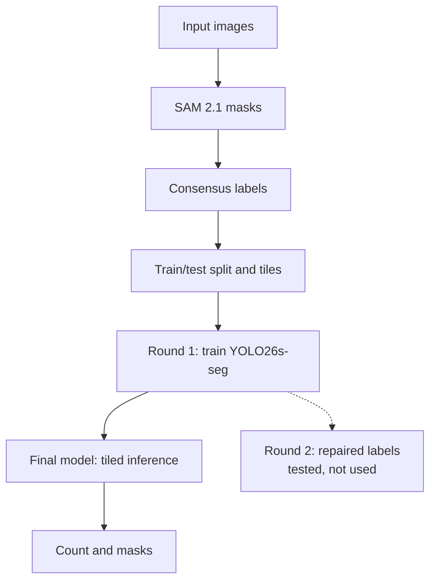

# AI Solution

A YOLO26s-seg model counts the objects and draws a mask on each one. It scores 99.81% mean accuracy on all 25 images, with no image below 95%. No labels were drawn by hand.

## Pipeline



## Training method

1. **SAM labels** ([notebook 01](notebooks/01_sam_labels_colab.ipynb)): SAM 2.1 segments 640×640 tiles. Alone, it splits some screws in two and misses many black screws.
2. **Consensus labels** (`src/make_consensus_labels.py`): each SAM mask is matched to a Non-AI v2 object. Pieces of one object are joined, and Non-AI v2 fills in what SAM missed.
3. **Dataset** (`src/build_dataset.py`): only `ScrewAndBolt_20240713` is used for training. 5 test images are held out, and 13 images become 270 training and 32 validation tiles.
4. **Training** ([notebook 02](notebooks/02_train_pseudo_label_colab.ipynb)): `yolo26s-seg.pt` is fine-tuned on a Colab T4 GPU in about 33 minutes.

| Setting | Value |
|---|---|
| Classes | 1 (`object`) |
| Image size, batch size | 640, 16 |
| Epochs | 120 maximum, patience 30 (best epoch 56) |
| Augmentation | rotation ±180°, flips, scale 0.3, mosaic |

**Round 2 was rejected.** Round 1's confident predictions repaired the training labels (350 refined, 19 merged), and the model was retrained. Validation scores barely changed, but accuracy on all 25 images fell to 97.90%, so Round 1 is the final model.

## Inference

`src/count_ai.py` resizes each image to 2048 px on the long side and runs the model on 640×640 tiles with 160 px overlap. It then removes duplicates across the full image, counts what remains and draws the masks.

## Results

| Images | Count | Round 1 (final) | Round 2 | Non-AI v2 |
|---|---|---|---|---|
| Test, held out | 5 | **99.80%** | 97.80% | 99.69% |
| `Screws_2024_07_15`, not trained on | 7 | 99.67% | 94.35% | **100.00%** |
| Training images | 13 | **99.88%** | 99.84% | 99.47% |
| All | 25 | **99.81%** | 97.90% | 99.66% |

Round 1 is off by one object on 4 images and exact on the other 21. Its worst image scores 97.7%.

**Limits:** the challenge has no official ground truth, so accuracy is measured against [`reference_counts.csv`](../reference_counts.csv), taken from another public submission. The labels also depend on Non-AI v2, so an error shared with it would not show up in these scores.

## Run

From `AI/`, where `<data>` is the absolute path to the folder holding the dataset folders:

```bash
pip install -r ../requirements.txt
python src/count_ai.py --weights weights/best.pt --data <data> --out results
```

Overlays, `predictions.csv` and training metrics for both rounds are in `results/`.
