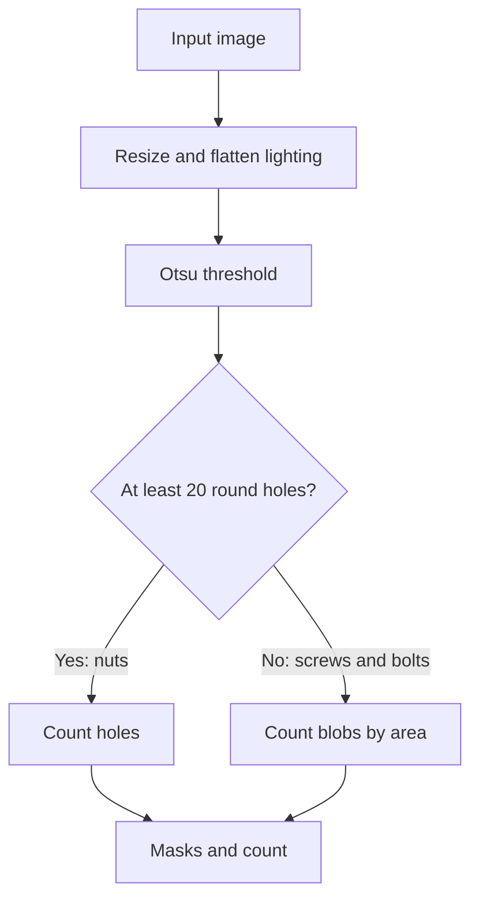

# Non-AI Solution

This solution uses classical computer vision only (OpenCV, SciPy, scikit-image), with no learned weights. **v2 is the final version.** v1 is kept for comparison.

| Version | Mean accuracy | Worst image | Images below 95% | Details |
|---|---|---|---|---|
| v1 | 97.61% | 84.7% | 2 | [v1/README.md](v1/README.md) |
| **v2 (final)** | **99.66%** | **98.0%** | **0** | [v2/README.md](v2/README.md) |

Accuracy is measured against [`reference_counts.csv`](../reference_counts.csv), which is not official ground truth.

## How it works



1. **Prepare:** resize the long side to 1600 px, divide by the estimated background to even out the lighting, and apply Otsu thresholding. Blobs in the dark image corners are ignored.
2. **Choose the scene:** at least 20 round holes surrounded by metal means a nut scene.
3. **Count and mask:** apply the rule for that scene, described below.

## Logic

- **Nuts are counted by holes.** Nuts in a pile touch too much to separate, but each visible hole marks one nut. Each pixel's mask goes to its nearest hole.
- **Screws are counted by area.** Touching screws merge into one blob, so blob area divided by the area of one screw gives the count. Masks come from k-means seeds and watershed.
- **The area of one screw is learned per image.** It is the left-most peak of the blob-area histogram, because single screws are the smallest common size.
- **Round heads are handled separately.** A head-down screw looks like a disc with about 1.45× the area of a side-on screw. Discs are counted first so they don't inflate the area count.

**Limits:** a nut with a fully hidden hole needs at least 0.6 of its area visible to be counted, masks for crossing screws are approximate, and some constants were chosen on these same 25 images.

## Run

From `Non_AI/v2/`, where `<data>` is the absolute path to the folder holding the dataset folders:

```bash
pip install -r ../../requirements.txt
python count_objects.py --data <data> --out results
```
