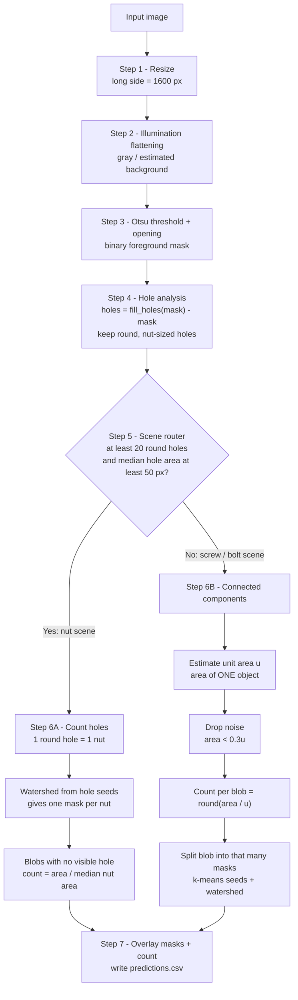

# Non-AI Solution: Classical OpenCV Counting

This pipeline counts screws, bolts and nuts in each image and draws an instance mask over every object. It uses **no learned weights**, only image processing, morphology and geometry (OpenCV, SciPy, scikit-image).

All code is in [`count_objects.py`](count_objects.py).

---

## 1. Overview



---

## 2. Step-by-step

### Step 1: Resize (`load`)

Images come in two sizes: 1451×1080 (`Screws_2024_07_15`) and 4000×3000 (`ScrewAndBolt_20240713`). Each image is resized so its **long side is 1600 px**.

**Why:** all kernel sizes and area thresholds then behave the same on every image, and processing is fast.

---

### Step 2: Illumination flattening (`foreground_mask`)

Some images have dark corners (vignetting) or uneven light. One global threshold would treat the dark corners as objects.

1. Convert to grayscale.
2. Estimate the **background**:
   - A grey-level **closing** with a 61×61 ellipse removes the dark objects, because they are smaller than the kernel, and leaves only the background.
   - A **Gaussian blur** (σ = 15) smooths that estimate.
3. Divide: `normalized = gray / background × 255`.

After this the background is evenly bright and objects are evenly dark, wherever they are in the frame.

---

### Step 3: Threshold to a binary mask (`foreground_mask`)

1. Apply a small Gaussian blur (5×5) to suppress sensor noise. This matters for `img1_43_nosy.jpg`.
2. Apply an **Otsu threshold**, inverted because objects are darker than the background. Otsu chooses the cut-off automatically, so no threshold is hard-coded.
3. Apply a **3×3 morphological opening** to remove specks of dust.

The result is a binary mask: white = object, black = background.

> Holes are **not** filled here on purpose. A nut's centre hole and the gaps between touching objects must not count as object area. Step 4 uses those holes.

---

### Step 4: Hole analysis (`nut_holes`)

The key idea: **every hex nut has exactly one round hole**, and it stays visible even when hundreds of nuts touch.

1. `filled = fill_holes(mask)`
2. `holes = filled − mask`. This keeps every background region fully enclosed by object pixels.
3. Each enclosed region is one of two things:
   - a **nut hole**: round and of consistent size, or
   - a **gap** between touching objects: irregular and of varying size.
4. Measure the **circularity** of each region: `4π·Area / Perimeter²`. A circle scores 1.
   - Keep regions with circularity **> 0.7**.
   - Keep only sizes between **0.4× and 2.2× the median** hole area. This rejects tiny slots and large merged gaps.

---

### Step 5: Scene router (`count_image`)

The dataset holds two very different kinds of scene, so the pipeline picks a counting method per image:

| Condition | Route | Reason |
|---|---|---|
| ≥ 20 round holes **and** median hole area ≥ 50 px | **Nut branch (6A)** | Dense nut piles: holes are the reliable signal |
| Otherwise | **Blob branch (6B)** | Screws and bolts: no holes (screw-head slots are only about 20 px) |

---

### Step 6A: Nut branch (`count_nuts`)

1. **Count = number of nut holes.** One hole means one nut, and gaps were already rejected in Step 4.
2. **Masks:** a marker-based **watershed** runs on the distance transform of the filled mask. The seeds are the hole regions, so each nut grows outward from its own hole until it meets its neighbours.
3. **Fallback:** some blobs contain no visible hole, for example a nut lying on its side. They are counted as `round(area / median nut area)`.

---

### Step 6B: Blob branch (`count_image`, `unit_area`, `split_component`)

Screws are elongated. Watershed on a screw finds several "peaks" along the shank and over-counts: one image read 32 instead of about 11 before this design. So this branch counts by **area**, not by watershed.

1. **Connected components** on the mask. Each component is one object or a group of touching objects.
2. **Unit area `u`**, the area of a single object, estimated from this image's own data:
   - Start at the 25th percentile of component areas.
   - Repeat: `u = median of areas in [0.6u, 1.4u]` until it stops changing.
   - This lands on the most common component size, which is a single object, even when many components are clumps.
3. **Noise filter:** drop components smaller than `0.3u`.
4. **Count per component** = `max(1, round(area / u))`. A clump of 3 touching screws has about 3u area, so it counts as 3.
5. **Masks:** a component that holds `k > 1` objects is split into `k` instances:
   - `k`-means on the pixel coordinates gives `k` seed points.
   - A watershed on the distance transform moves the cut lines to the narrow "necks" where objects touch.

---

### Step 7: Output (`overlay`, `main`)

For every image:
- an overlay image: each instance gets a random colour blended at 55% opacity, a red contour, and the total count in the top-left corner
- one row in `results/predictions.csv`: `image, predicted, mode` (`mode` = `nuts` or `blobs`)

---

## 3. Design decisions at a glance

| Challenge in the data | Classical answer |
|---|---|
| Vignetting and uneven lighting | Divide by an estimated background before thresholding |
| Hundreds of touching hex nuts | Count **holes**, not blobs |
| Elongated screws: watershed over-splits | Count by **area / unit area**; use watershed only to draw masks |
| Object size changes between images | Unit area estimated **per image**, with no hard-coded sizes |
| Noisy image (`img1_43_nosy.jpg`) | Gaussian blur, opening, and the `0.3u` noise filter |

## 4. Known limitations

- **Mixed scenes** (side-view screws next to head-on screws seen as round dots) have two object sizes. A single unit area can over- or under-count one of the two types.
- **Heavily overlapping objects:** if one object covers another's hole or most of its area, it may be missed.

## 5. Run

```bash
pip install -r ../../requirements.txt
python count_objects.py --data <data> --out results
```

Output: overlay images and `predictions.csv` in `results/`.
