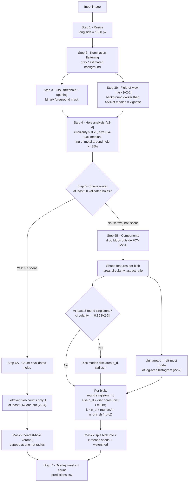

# Non-AI v2: Classical OpenCV Counting (improved)

v2 keeps v1's segmentation and changes the **counting logic**: what counts as one object, and how a clump is split into objects. Every change targets a failure observed in v1. Each change is tagged `[V2-n]` in [`count_objects.py`](count_objects.py).

There are still **no learned weights**: OpenCV, SciPy and scikit-image only.

---

## 1. Pipeline overview



---

## 2. What changed from v1 and why

| Tag | Change | v1 failure it fixes | Evidence |
|---|---|---|---|
| **V2-1** | **Field-of-view mask.** Where the estimated *background* is darker than 55% of its median (vignette corners), blobs are ignored | `Screws/img3`–`img6` counted **44–45 instead of 43** | Every extra blob sat at x ≈ 5 px, in the black vignette corner |
| **V2-2** | **Unit area = left-most mode of the log-area histogram**, not an iterative median | The median drifts upward when touching pairs outnumber singletons | Singletons are the smallest common size; pairs and triples form peaks at 2× and 3× |
| **V2-3** | **Round-object (disc) model.** Screws lying head-down look like round discs (circularity ≈ 0.95, area ≈ 1.45u). They are detected as singletons and, inside clumps, as distance-transform cores ≥ 0.8r. They are counted separately before the area-based count of the remaining screws | Mixed scenes: v1 counted **113 / 109** where there are about **98** objects. Each disc inflated the area-based count | Measured on `194200`: 8 round singletons, circularity 0.94–0.96, area 786–848 px against u = 566 px |
| **V2-4** | **Stricter nut holes:** circularity > 0.75, size 0.4–2.0× median, and ≥ 85% of a circle at 1.6× the hole radius must be metal. Leftovers count only if ≥ 0.6× a nut. Masks come from nearest-hole Voronoi capped at one nut radius | Nut pile counted 357–370 (five photos of the same pile). Some gaps between nuts were accepted as holes, and v1's watershed masks streaked across the pile | Counts now 354–359; each nut gets a hexagonal mask |
| **V2-5** | Speck filter 0.3u → 0.25u | Small, but keeps small partly hidden objects | |
| **V2-6** | **Crowding factor c = 1.10** inside clumps (> 2.5u), only in disc scenes | Screws that lean on round heads tilt and show more of their head, so each takes about 1.1u inside a clump | Chosen by **leave-one-image-out** on the 6 mixed images: every fold picked c = 1.10, and held-out accuracy was 98–100%. Dense screw piles (no discs) are unaffected |

---

## 3. Step-by-step

Steps 1–3 are the same as v1 (see [`../v1/README.md`](../v1/README.md)): resize to 1600 px, divide by the estimated background, Otsu threshold and a 3×3 opening.

### Step 3b: Field-of-view mask [V2-1] (`segment`)
The background estimate from Step 2 is reused. Pixels where the background itself is darker than **55% of its median** are outside the usable field of view. This mask is eroded by 25×25 for a safety margin. A blob with less than **70%** of its pixels inside the field of view is ignored.

### Step 4: Hole analysis [V2-4] (`nut_holes`)
1. `holes = fill_holes(mask) − mask` gives every enclosed background region.
2. Keep regions with circularity `4πA/P² > 0.75` whose centre is inside the field of view.
3. Keep regions whose area is between **0.4× and 2.0×** the median candidate area.
4. **Ring test:** sample 36 points on a circle of radius 1.6 × the hole radius. A real nut hole is surrounded by metal, so at least 85% of those points must be foreground.

### Step 5: Scene router (`count_image`)
If at least 20 holes pass validation and the median hole area is at least 50 px, the image is a nut scene. Otherwise it is a screw/bolt scene.

### Step 6A: Nut branch (`count_nuts`, `nut_area`)
1. **Count = number of validated holes.**
2. **Nut size:** take the median area of blobs that contain exactly one hole (isolated nuts). The nut radius follows from it.
3. **Masks:** every foreground pixel goes to its nearest hole (`distance_transform_edt` with `return_indices`), but only within 1.1 × the nut radius, so no mask can stretch across the pile.
4. **Leftovers:** foreground left unassigned counts as `floor(area / nut + 0.4)` nuts, so a leftover adds a nut only when it is at least 0.6 of a nut.

### Step 6B: Blob branch (`count_blobs`, `unit_area`, `disc_cores`)
1. Take connected components, drop blobs outside the field of view, and compute area, circularity and minimum-area-rectangle aspect ratio for each.
2. **Disc singletons:** blobs with circularity ≥ 0.85, aspect ratio ≤ 1.25 and area > 0.6u. If there are at least 3, the disc model is active: `a_d` = their median area and `r = √(a_d/π)`.
3. **Unit area u** of a side-view screw:
   - Build a 40-bin histogram of log(area) over the non-disc blobs and smooth it with [1,2,3,2,1].
   - Take the **first** local peak that reaches at least 35% of the highest peak.
   - u = median area within 0.7–1.4× that peak.
4. **Per blob:**
   - Drop blobs smaller than 0.25u.
   - A round singleton (smaller than 1.6·a_d) counts as **1**.
   - Otherwise:
     - `n_d` = the number of connected regions where the distance to the blob edge is at least 0.8r. A side-view screw is only about half a disc wide, so these cores only exist inside discs.
     - `k = n_d + round((A − n_d·a_d) / (u·c))`, where `c = 1.10` for clumps larger than 2.5u in disc scenes and 1 otherwise.
5. **Masks:** a blob holding `k > 1` objects is split with k-means seeds and a distance-transform watershed (as in v1). If the watershed leaves any region far too small, the plain k-means partition is used instead. This affects masks only, not the count.

### Step 7: Output
- An overlay image per input, with coloured instance masks, red contours and the count.
- `results/predictions.csv` with columns `image, predicted, mode`.

---

## 4. Results: v1 vs v2

> **Provisional reference.** The challenge publishes no ground truth. The numbers below compare against the only published per-image reference, from another public submission, saved in [`reference_counts.csv`](../../reference_counts.csv). That reference was itself partly built from model labels, so treat these numbers as indicative.
>
> Some constants (c = 1.10, the 55% FOV threshold) were chosen on these same images. c was checked with leave-one-image-out.

| Image group | Reference | v1 | v2 |
|---|---|---|---|
| Sparse pan-head screws (192951, 193135) | 21, 21 | 21, 21 | 21, 21 |
| Sparse screws (193650, 193659) | 10, 10 | 10, 10 | 10, 10 |
| Dense screw piles (193831, 193839, 193907) | 193, 195, 193 | 193, 196, 194 | 193, 196, 194 |
| Mixed screws + round heads (194200 … 194316) | 98, 99, 98, 98, 98, 99 | 113, 109, 101, 98, 102, 98 | 100, 100, 98, 98, 98, 98 |
| Nut pile, 5 photos (194541 … 194630) | 354 × 5 | 363, 370, 362, 358, 357 | 354, 358, 359, 357, 354 |
| Screws folder (img1, nosy, img2–img6) | 43 × 7 | 43, 43, 43, 45, 44, 44, 45 | 43 × 7 |

| Metric (25 images) | v1 | v2 |
|---|---|---|
| Mean accuracy | 97.61% | **99.66%** |
| Worst image | 84.7% | **98.0%** |
| MAE (objects) | 3.24 | **0.72** |
| RMSE | 5.62 | **1.52** |
| Signed bias | +3.16 | **+0.64** |
| Images below 95% | 2 | **0** |

Runtime: about 0.4 s per image on an Apple M4 CPU (25 images in about 10 s).

## 5. Known limitations
- **Fully hidden nut holes:** a nut whose hole is completely covered is only recovered if its visible area is at least 0.6 of a nut.
- **Crossing screws:** masks for screws that cross in an X are approximate. The count stays correct because it comes from area, but watershed cannot draw two overlapping masks.
- **The disc model needs at least 3 isolated round heads** in the image to learn their size.

## 6. Run

```bash
pip install -r ../../requirements.txt
python count_objects.py --data <data> --out results
# compare versions
python ../../evaluate.py --gt ../../reference_counts.csv ../v1/results/predictions.csv results/predictions.csv
```
