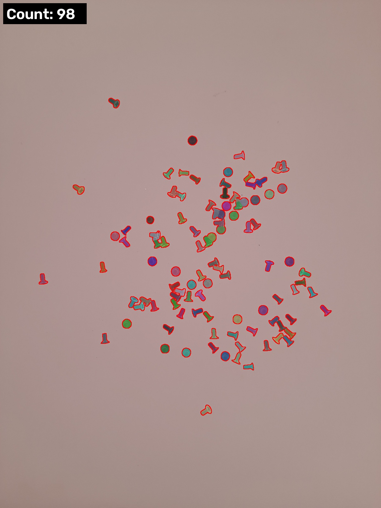
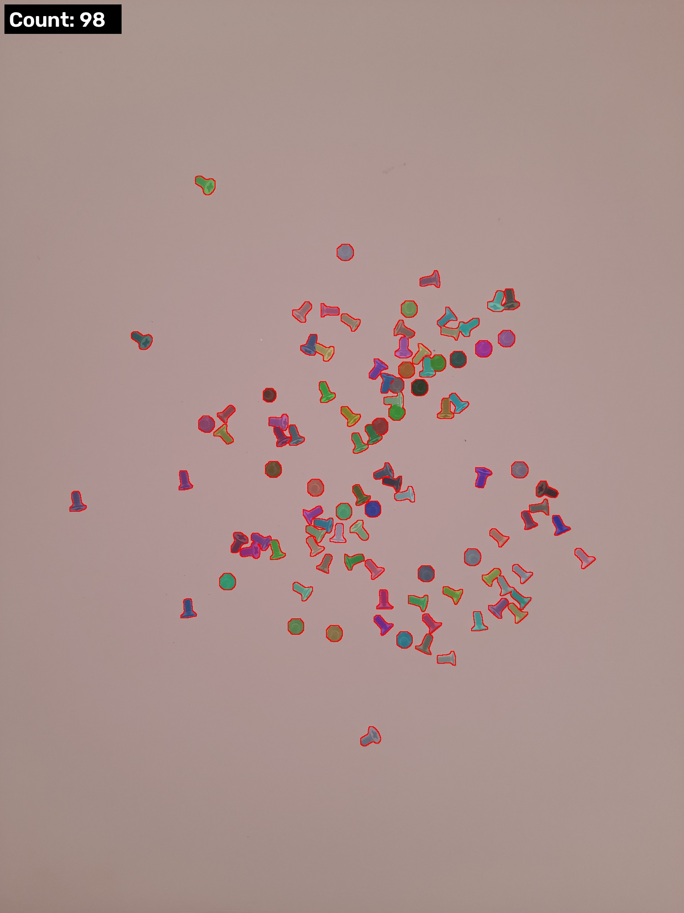

# CountingChallenge

**Author:** Ishant Kukreti  |  **Python:** 3.12

Counts the items in each image and overlays a mask on each item, using two separate solutions. Both exceed the 95% accuracy target on all 25 images.

| Solution | Method | Mean accuracy | Worst image |
|---|---|---|---|
| [`Non_AI/`](Non_AI/) (v2) | Classical computer vision: holes for nuts, area for screws | 99.66% | 98.0% |
| [`AI/`](AI/) | YOLO26s-seg trained on SAM 2.1 pseudo-labels | 99.81% | 97.7% |

The challenge has no official ground truth, so accuracy is measured against [`reference_counts.csv`](reference_counts.csv), taken from another public submission. Treat the scores as indicative.

On the 5 held-out test images, the AI model scores 99.80%. Each folder's README covers its working and logic, and the training method is in [`AI/README.md`](AI/README.md).

| Non-AI v2 | AI |
|---|---|
|  |  |

## Run

`<data>` is the absolute path to the folder holding `ScrewAndBolt_20240713/` and `Screws_2024_07_15/`. The dataset is linked from the [challenge repository](https://github.com/perspectivLabs/CountingChallenge) and is not stored here.

```bash
pip install -r requirements.txt

cd Non_AI/v2 && python count_objects.py --data <data> --out results
cd ../../AI && python src/count_ai.py --weights weights/best.pt --data <data> --out results
```

To score the results, from this folder:

```bash
python evaluate.py --gt reference_counts.csv NonAI=Non_AI/v2/results/predictions.csv AI=AI/results/predictions.csv
```
